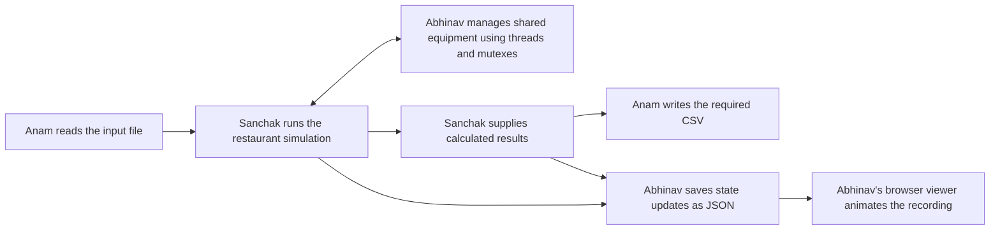

# Our restaurant project: what we are building and who does what

This is our working plan for **Abhinav, Sanchak and Anam**. It describes work still to be done, not features that already exist.

## 1. The idea

We already have a C program where orders arrive and two chefs cook them. It can choose the next order using FCFS, Priority or SJF. We are adding two things:

- **A2: finding space for an order.** Before cooking, an order needs a continuous group of waiting-space slots and possibly table slots. If it cannot get both, it waits.
- **A3 / Final Project: sharing kitchen equipment.** While cooking, orders may need the microwave, an oven or the coffee machine. We use real threads and mutexes so two orders cannot use the same equipment at once. We also show and prevent deadlock.

Alongside this, we are building a **pixel-art restaurant in the browser**. The C program runs the simulation and saves what happened in a JSON file. We select that file in the browser and watch the chefs, queues, tables and equipment change over time.

The browser is playing a recording of the C run. It does not replace the real threads required for A3. A raw assignment input `.txt` needs to be run through C first; a `.json` or `.txt` containing our saved JSON recording can be opened directly in the viewer.

**Dates:** A2 and A3 are both due **November 21, 2026, end of day**, as confirmed. They need **separate runnable submissions**. Our joint presentation/viva is **November 23**: five minutes presenting and five minutes answering questions.

## 2. A small example

Suppose O1 needs two space slots, one table slot and four units of cooking time.

1. O1 arrives. The simulator looks for two adjacent free SPACE slots and one TABLE slot.
2. If either request cannot fit, O1 waits. It does not reserve half its request.
3. When both fit, O1 reserves them and joins the orders ready for a chef.
4. A free chef starts O1 according to the selected scheduling algorithm.
5. In A3, O1 might request the microwave after one unit of cooking. If another order owns it, O1 stops cooking and gives up the chef, but keeps its space/table allocation.
6. When the microwave becomes available and the safety policy allows it, O1 becomes ready for a chef again.
7. O1 finishes, having released its equipment. Its space/table slots are freed.
8. The browser shows these changes using the recording from C.

The simulation clock is a counter, not a requirement to wait real seconds. The browser can replay four simulation units slowly or quickly without changing the results.

## 3. Who is doing what?

| Person | Main responsibility | What they hand over |
| --- | --- | --- |
| **Sanchak** | The restaurant's simulation rules: scheduling, memory, queues, timing and calculated results | Working A2/A3 simulation, complete state updates, calculated result records and correctness examples |
| **Anam** | Reading process inputs, command-line options, writing the required CSV, comparison scripts and submission documentation | Validated orders/configuration, exact CSV output, repeatable run commands, comparison table and release archives |
| **Abhinav** | Threads, mutexes, equipment sharing and deadlock; everything related to visualization | Equipment manager, concurrency examples, JSON recordings, browser viewer and all pixel-art assets |

Each person has a separate brief with steps, files, deliverables, checks and a ready-to-copy agent instruction:

- [Sanchak: simulation and memory](docs/tasks/sanchak.md)
- [Anam: inputs, outputs and run scripts](docs/tasks/anam.md)
- [Abhinav: synchronization and visualization](docs/tasks/abhinav.md)

For exact field names and how the parts connect, use [the shared data guide](docs/shared-data.md). You do not need to read everyone else's implementation to start your own part.

## 4. How our parts connect

There are two outputs for different purposes:

- **`result.csv`:** the exact file format expected by the assignment. Anam writes it using numbers Sanchak has already calculated.
- **`run.trace.json`:** the animation recording. Abhinav writes it using state updates supplied by Sanchak and equipment information supplied by Abhinav's resource manager.

For example, if the viewer needs `pools.SPACE`, Sanchak provides the six slot owners and Abhinav converts that array into JSON and draws it. Sanchak does not need to write browser code or learn the sprite format.

## 5. How we can start without waiting for each other

We agree on the shared field names in the [data guide](docs/shared-data.md). Then:

| Person | First task | What to use while the other parts are unfinished |
| --- | --- | --- |
| Sanchak | Implement/test memory allocation and the simulation loop | Small orders constructed directly in C; a test equipment manager that returns chosen answers |
| Anam | Read a valid input, reject bad inputs, format CSV rows | Small input files and a manually filled result structure |
| Abhinav | Make the viewer load a sample recording; build the equipment manager separately | A hand-written JSON recording and small C thread tests |

“Sample” or “test” data just means a small example whose answer we already know. It lets us work separately. Before submitting, we replace these stand-ins with the actual connected modules.

Sanchak creates the shared C type definitions first; Abhinav defines the recording format and callback declaration with him. Anam uses those definitions instead of inventing a second Process/Result type. While that small shared change is being prepared, parser examples, allocation tests and browser work can all begin.

## 6. Order of work

### First: finish A2 together

- [ ] Agree the shared C data structures and a small example recording.
- [ ] Anam adds seven-field process input and CLI options.
- [ ] Sanchak adds SPACE/TABLE allocation, FIFO waiting and integration with the existing schedulers.
- [ ] Sanchak calculates the required results; Anam writes them in the required CSV format.
- [ ] Abhinav connects the recording writer and the browser's memory/chef view.
- [ ] Run all **nine combinations**: three schedulers × three allocators. Add the comparison table to README.
- [ ] Check A2 from a clean extracted archive, then mark that version with `a2-v1.0.0`.

### Then: add A3, keeping A2 working

- [ ] Sanchak adds resource/action input and pauses orders at the right cooking offsets.
- [ ] Abhinav adds actual workers, safe equipment ownership and waiting/wakeup.
- [ ] Connect blocked orders back to Sanchak's scheduler when equipment becomes available.
- [ ] Abhinav adds a bounded unsafe deadlock example and an enabled prevention policy for normal runs.
- [ ] Sanchak calculates resource waiting; Anam adds the final CSV fields and checks.
- [ ] Abhinav shows equipment contention and worker evidence in the browser.
- [ ] Check the A2 baseline still gives the same numbers, test A3, package separately and tag `a3-v1.0.0`.

We can prepare A3 pieces while A2 is being finished, but the A2 submission must remain runnable by itself. Given the deadline, start with simple pixel placeholders. Improve the art after the required behavior works. Avoid adding gameplay, ingredients, sounds or other extras until the main demo is complete.

## 7. What counts as finished?

An individual task is finished when:

1. Its code works on a small example with a known answer.
2. The next person's module can use its output without guessing field names or meanings.
3. Its relevant checks pass, and the person responsible can explain the code.
4. It is committed with a short explanation and run/test command.

For the complete project, check correct slot ownership, no lost orders, no overlapping use of the same equipment, all orders finishing, all slots/equipment released, exact CSV formats and a viewer that matches the recording. The browser should work on Windows and macOS; test C/thread portability separately and record the actual tested environments.

We previously verified that the existing build, 30 scheduling row comparisons, priority snapshot and terminal Gantt check pass. That is our starting point, not proof that A2/A3 already work.

## 8. Simple Git rules

- Work on a branch such as `codex/sanchak-memory`, `codex/anam-input-output` or `codex/abhinav-viewer`.
- Make one focused feature commit at a time. Examples: `feat(memory): add first fit allocation`, `feat(input): read A2 process fields`, `feat(viewer): add pause and step controls`.
- Include relevant tests/docs with the feature. Keep the project runnable when merging into the shared branch.
- Commit only your intended files. Do not add executables, temporary outputs or someone else's unfinished edits.
- Tell the team before changing a shared header or file format. Update the example data too.
- Before handing over, share the commit, what changed, how to run it and anything still missing. Have another teammate review it.

## 9. Submission and presentation

Anam assembles the two archives using the files each owner supplies. Each person verifies their own part. Agree who submits and who is the backup; only one member needs to submit each archive.

For the five-minute demonstration: Anam explains the inputs/results, Sanchak explains scheduling/memory, and Abhinav explains synchronization and shows the browser. Everyone should understand the complete flow for questions.

Assignment requirements come from the restaurant sections of [A2](OSLab_CS_3710__A2_Specifications.pdf) and [A3 / Final Project](OSLab_CS_3710__Final_Project_Specifications.pdf). Other scenarios in those PDFs are outside our project. The browser/JSON design and work split are our team's choices.
