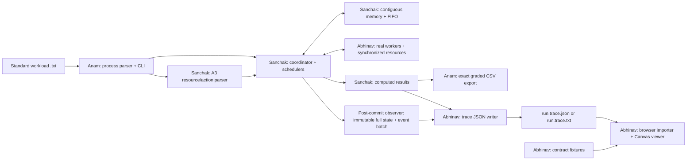
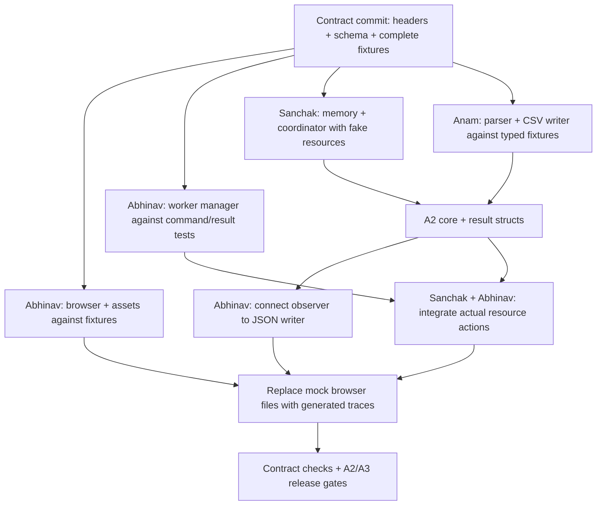

# Smart Restaurant: A2 and A3 delivery plan

Status: revised implementation plan, November 20, 2026. This document plans future work; its checkboxes do not claim implementation. No implementation or asset generation is part of this planning change.

## 1. Scope, authority, and confirmed decisions

The user's request is to review the existing work and produce this plan. The attached specifications supply the assignment requirements; their submission instructions are recorded as future team tasks, not instructions to submit or modify anything now. Only the **Smart Restaurant** scenario applies.

Confirmed with Abhinav:

- A3 means the attached **Final Project**.
- Both A2 and A3 are due **November 21, 2026, end of day**. The joint presentation/viva is **November 23**: five minutes presenting and five minutes answering questions.
- The team is **Abhinav, Sanchak, and Anam**, all equally proficient.
- Abhinav wants primary ownership of **mutexes/synchronization and visualization**.
- Visualization is a **browser application** used on Windows and macOS. Select a locally generated simulation JSON/text trace, choose a case, and animate its recorded actions. The C program remains the authoritative simulator.
- **All visualization work belongs to Abhinav**, including browser code, trace JSON/schema/serialization, fixtures for frontend development, assets, menus, controls, UI checks, and visual documentation.
- Deliver A2 and A3 as separate, independently runnable checkpoints and archives, even though development shares one repository.

Proposals in this plan: a static HTML/CSS/JavaScript Canvas viewer, a versioned snapshot-based JSON trace, module boundaries, exact task allocation, asset dimensions, and commit/review conventions. These are engineering recommendations, not PDF requirements. No browser backend, WebSocket service, C-to-WebAssembly port, or native graphics dependency is needed for the first release. Art style, target browser versions, available test machines, and the particular deadlock-prevention policy remain decisions to settle before dependent implementation.

Source references use PDF sections/pages:

- [A2 specification](OSLab_CS_3710__A2_Specifications.pdf): restaurant mapping and admission §§3–6, metrics/input/output §§7–9, comparisons and delivery §§10–15.
- [Final/A3 specification](OSLab_CS_3710__Final_Project_Specifications.pdf): resources and concurrency §§3–5, deadlock §6, retained semantics and contracts §§7–9, integrated demonstration and submission §§10–14.

## 2. Current repository assessment

Reviewed working tree at commit `d1e9858`, including the locally modified README. Existing README edits, untracked PDFs, and untracked `restaurant`/`gantt_chart` executables belong to the existing workspace and must not be accidentally staged or overwritten.

| Area | Existing work | Next action |
| --- | --- | --- |
| Scheduling | `sched.c`: FCFS, non-preemptive PRIORITY, SJF; deterministic arrival/ID tie-breaking | Preserve; only READY orders are eligible |
| Simulation | `sim.c`: event-driven virtual time, two chefs, arrivals/completions | Add memory admission and later resource actions; retain two execution units |
| Model | `restaurant.h`: NEW/READY/RUNNING/TERMINATED and service fields | Add allocation metadata, waiting states, action progress, trace interfaces |
| Input | `input.c`: five-field A1 records using `fscanf` | Strict seven-field A2 records, then optional A3 sections; diagnose malformed data |
| Reporting | `metrics.c`: A1 human-readable CSV-like output | Versioned A2/A3 standard exports; more decimal precision |
| Visualization | `gantt_chart.c`: terminal chart parses current A1 stdout via `popen` | Preserve as legacy tooling or adapt; produce a separate structured trace for the browser |
| Tests | Shell scripts, fixtures, expected scheduling rows | Preserve A1 checks; add A2/A3 oracles and portable test execution |
| Build | Small Makefile, no graphical or concurrency dependency | Keep the CLI; isolate platform threading and package a static browser viewer |
| Docs | A1 README, including stale statement that schedulers are placeholders | Correct descriptions when corresponding changes land |

Baseline verification on November 20, in a temporary copy so local binaries were untouched:

- `make`: passed, with three unused `t` parameter warnings in scheduler functions.
- `sh tests/edge/check_rows.sh`: **30 passed, 0 failed**.
- `sh tests/test_priority.sh`: passed.
- `sh tests/gantt_chart_test.sh`: passed.

Limits of that evidence: the row-check script runs ten edge input files × three algorithms; it does not exercise every expected-output file in the repository. `tests/run_all.sh` prints results rather than asserting them. These checks establish an A1 baseline, not A2/A3 correctness or Windows compatibility.

Concrete gaps: no contiguous allocator, admission FIFO, memory metrics, standardized A2 export, resource action parser, real workers, synchronization, deadlock prevention, or browser visualization. Parser validation lacks many required range/uniqueness checks. Existing two-decimal statistics may violate the new `10^-3` tolerance. The Gantt parser depends on the old header and fixed field positions and cannot represent resource-blocked service intervals correctly.

## 3. Team ownership and review

Each owner supplies implementation, relevant checks, and module notes. The allocation below keeps core state transitions under one owner and the entire visualization pipeline under Abhinav.

| Person | A2 ownership | A3 ownership | Review and demonstration |
| --- | --- | --- | --- |
| **Abhinav** | Browser viewer, JSON contract and trace writer, mock traces, all visual assets, menus, playback, memory/chef views | Worker/thread abstraction, mutexes/conditions, resource manager, prevention and bounded unsafe demo; resource visualization | Review core/resource handoffs with Sanchak; present concurrency and visualization |
| **Sanchak** | Core types, event coordinator, scheduling integration, SPACE/TABLE allocators, FIFO admission, occupancy and scheduling metric calculations | Resource action parser, work-offset handling, BLOCKED_RESOURCE integration, resource waiting calculations, integrated correctness tests | Review synchronization invariants and trace state against core state; present scheduling and allocation |
| **Anam** | Seven-field process-input parser/validation, CLI argument handling, standard CSV formatting from supplied results, comparison runner, README/build commands and baseline checks | Extend CSV formatting for supplied A3 results, resource-free regression runner, examples, release checklists and archive preparation | Check standard file formats and repeatable examples; present input/output and comparison results |

Abhinav owns asset sourcing, creation, sprite preparation, licensing records, visual packaging and browser testing. Other members expose domain data through the agreed C interfaces; they do not implement frontend helpers, JSON serialization, sprite metadata, or menu configuration.

Sanchak owns `sim.c`, `sched.c`, memory modules and core types. Anam owns process input, `main.c`, CSV export, comparison scripts and release documentation. Abhinav owns resource/thread modules, trace contracts/writer and `web/`. Sanchak adds the optional resource/action parser as a separate module called after Anam's process parser. Agree header changes through a small contract commit before parallel implementation; avoid concurrent edits to the same file and unrelated formatting churn.

## 4. Architecture and independent development contracts

### 4.1 System boundary

The **C CLI runs A2/A3** and produces two separate artifacts: the exact graded CSV and an optional browser trace. The **static browser viewer loads the trace locally and replays it**. Replay speed, pause and seek affect presentation only. Changing a scheduler, allocator or workload requires another C run and another trace; a viewer selector can choose among already generated runs but cannot silently recompute OS behavior in JavaScript.

A3 still executes actual concurrent C workers. A recording can make their events inspectable, but browser animation alone does not prove real concurrency. Keep a CLI concurrency demonstration and worker evidence with the submission.



### 4.2 Module interfaces: what each person supplies

These are proposed public contracts to freeze in the first implementation commit; names may change together before that freeze. The following paths are planned, not files already created. Public structs must have explicit lengths and checked numeric bounds; use stable process IDs/indices, not JSON-visible pointers.

| Planned interface/module | Producer → consumer | Required interface/data | Independent development substitute |
| --- | --- | --- | --- |
| `include/model.h` | Sanchak → everyone | `ProcessSpec`, `Workload`, `SimulationConfig`, state/policy enums; owned strings and action arrays | Shared header and tiny validated `Workload` builder |
| `input.c` | Anam → Sanchak | `read_process_section(FILE *, Workload *, Error *)`; consumes N/Q and exactly N process rows, leaves stream at optional sections; cleanup on failure | Sanchak constructs the same typed workload in tests |
| `resource_input.c` | Sanchak → coordinator | `read_resource_sections(FILE *, Workload *, Error *)`; EOF means zero actions; otherwise validates R/K and action semantics | Zero-action and two-resource typed fixtures |
| `memory.c` | Sanchak → coordinator | `plan_allocation`, `commit_allocation`, `release_allocation`; two-pool plan is atomic, handles record exact ranges | Tiny memory-only tests independent of CLI/viewer |
| `include/simulation.h` | Sanchak → Anam/Abhinav | `simulate(const Workload *, const SimulationConfig *, const ResourceOps *, const SimulationObserver *, SimulationResult *, Error *)` | A2/no-resource adapter, deterministic fake observer driver |
| `include/resource.h` | Abhinav → Sanchak | `ResourceOps`: submit action batch, drain results, inspect immutable ownership/wait state, shutdown; result is GRANTED/BLOCKED/RELEASED/ERROR with IDs | Fake resource manager for coordinator tests, clearly labeled test-only |
| `include/observer.h` | Sanchak implements emission → Abhinav implements callback | `on_commit(const StateView *, const EventBatch *, void *context)`; complete consistent post-batch state and ordered reasons, called outside locks | Abhinav's mock producer feeds the trace writer before core integration |
| `include/result.h` | Sanchak → Anam/Abhinav | Final process/summary/pool/resource/check structs; all metrics already computed, no exporter calculations | Hand-calculated A2/A3 result fixtures |
| `metrics.c` / export module | Anam → CLI | `write_standard_csv(FILE *, const SimulationResult *, Phase, Error *)`; exact PDF record order/precision | Format result fixtures without waiting for simulator |
| `trace.c`, `contracts/trace-v1.schema.json` | Abhinav → browser | Begin run, append full frame, attach final result/worker evidence, finalize JSON | Hand-authored schema-valid traces and mock observer |
| `web/` | Abhinav → user | Local file import → validated trace → playback → Canvas/panels | Same versioned fixture files used by C trace-writer checks |

**Ownership/lifetime:** Anam's parser builds an owned `Workload`; CLI frees it after simulation. Sanchak owns mutable process/memory/time state and computed `SimulationResult`. Abhinav owns resource-manager mutable state behind its lock. Observer pointers are read-only and valid only for the callback; Abhinav's writer copies/serializes them synchronously before return. Browser objects are independent parsed copies. No raw mutable pointer crosses a worker queue.

**Failure boundary:** return structured error codes and a useful field/line context; no module exits the process. Failed runs do not produce a successful graded export or a complete trace. CLI writes temporary outputs and finalizes them only after successful completion. Trace-output I/O errors are reported explicitly and do not alter simulation decisions. Normal runs must not hang when no future event can make progress.

The first contract commit must also define these shared payload fields, not just forward-declare opaque structs:

- `SimulationConfig`: phase, scheduler, allocator, prevention policy, run mode; trace destination is a writer/CLI concern, not an allocator option.
- `ProcessSpec`: all seven standardized fields. `ProcessRuntime`: state, admitted/start/completion times, executed/remaining service, chef assignment, exact SPACE/TABLE allocation ranges and accumulated wait intervals.
- `ResourceCommand`: unique command ID, logical batch/time, process ID, action index, work offset, ACQUIRE/RELEASE and resource ID. `ResourceResult`: matching command ID, outcome, resource holder, ordered affected waiters and worker evidence reference. No duplicate or stale result may be applied twice.
- `StateView`: frame time/sequence, all process runtime records, two chef assignments, both slot arrays, actual ready/admission queues and copied resource ownership/wait queues. `EventBatch` contains ordered transition reasons. Frame sequence numbering is assigned once by the coordinator.
- `SimulationResult`: phase/configuration plus per-process, summary, pool, resource and check records mapped one-to-one to §4.4; runtime state is never mutated to sort exports.

### 4.3 Event ordering and thread handoff

```mermaid
sequenceDiagram
    participant C as Sanchak: coordinator
    participant M as Sanchak: memory
    participant W as Abhinav: worker/resource manager
    participant T as Abhinav: trace observer
    C->>M: Complete eligible orders and free allocations
    C->>C: Register arrivals; admit FIFO; dispatch/action boundary
    C->>W: Submit due resource actions with IDs and work offsets
    W->>W: Two real workers perform synchronized operations
    W-->>C: Immutable grant/block/release results + ownership
    C->>C: Apply transitions; free blocked chefs; reschedule
    C->>T: on_commit(full post-batch state, ordered events)
    T-->>C: Return; retain no borrowed pointers
    C->>C: Advance virtual clock to next event
```

A2 skips the worker exchange. At an A3 timestamp, process zero-time action/wakeup/dispatch consequences until settled before advancing time. Do not advance past an unresolved action result. A worker waiting for a logical resource must return BLOCKED, freeing the worker for other operations; it must not occupy a worker indefinitely and prevent a holder's release from running. Condition waits are for synchronized command/result availability, with predicates checked in loops.

No module holds its lock while calling another subsystem, exporting files, or invoking observers. The coordinator is the only writer of process states and clock. Worker IDs identify real threads, not simulated chef numbers. A resource-grant decision must carry ownership consistently through unblock→READY→dispatch without double acquisition. Cancellation wakes queues, stops new commands, releases demo resources and joins workers.

### 4.4 Browser trace v1: exact producer expectations

Trace JSON is an **additional presentation artifact**, never a replacement for standardized input or graded CSV. Both `.json` and `.txt` trace files contain the same JSON object, detected by content. A raw seven-field workload `.txt` contains no execution history: the importer should identify it and explain the C command needed to produce a trace. It must not invent memory placements, resource races or timestamps from that input. No backend is required for file import.

Proposed CLI extension, retaining the standard four positional arguments:

```text
restaurant_cli workload.txt FCFS FIRST_FIT result.csv --phase a2 --trace run.trace.json
restaurant_cli workload.txt PRIORITY BEST_FIT result.csv --phase a3 --trace run.trace.json
```

| JSON path | Type/meaning | Source responsible for values | Consumer expectation |
| --- | --- | --- | --- |
| `schema_version` | Integer `1` | Abhinav: writer constant | Reject unsupported major versions |
| `run.id`, `run.phase`, `run.scheduler`, `run.allocator`, `run.prevention_policy` | Strings; phase `A2`/`A3`, canonical policy names, policy `NONE` only for A2/explicit unsafe demo | Anam passes config; Sanchak validates; Abhinav serializes | Labels and run selection; never infer policies from file name |
| `run.status`, `run.time_unit`, `run.end_time` | `COMPLETE`, `virtual_tick`, nonnegative integer | Sanchak | First release plays successful complete runs; unsafe demo is separately labeled and bounded |
| `run.mode` | `BASELINE`, `SAFE`, or `UNSAFE_DEMO` | Sanchak/Abhinav | Prominent unsafe/replay label; never infer from violations |
| `run.origin` | `RECORDED` or `SYNTHETIC` | Abhinav: actual writer or fixture author | Clearly mark synthetic examples; their worker evidence is never live-concurrency proof |
| `model.chef_count`, `model.pools` | `2`, `SPACE:6`, `TABLE:3` | Sanchak | Exact slot geometry, not decorative capacity |
| `model.processes[]` | `id, arrival, priority, service, category, space_req, table_req` | Anam parser; Sanchak validated model | Persistent identity and tooltips |
| `model.resources[]` | `{id, capacity}` for declared equipment | Sanchak resource parser | A2 is `[]`; show only declared A3 instances as active |
| `frames[].seq`, `frames[].time` | Contiguous sequence from 0; nondecreasing integer virtual time | Sanchak emission order; Abhinav serialization | Same-time frames ordered by seq, never sorted by event label |
| `frames[].events[]` | `{type, process_id, chef_id, resource_id, reason}`; nullable unused IDs | Sanchak committed transitions; Abhinav resource result reasons | Human-readable transition evidence; snapshot is authoritative |
| `frames[].processes[]` | `{id, state, executed_service, remaining_service, chef_id, waiting_for}`; all processes in each frame | Sanchak | No frontend service/wait calculations; `waiting_for` resource IDs, empty outside resource blocking |
| `frames[].chefs` | Exactly two entries: process ID or `null`; indices 0 and 1 | Sanchak | Chef animation based on assignment, never thread identity |
| `frames[].pools.SPACE`, `.TABLE` | Owner ID or `null` at each slot, lengths 6 and 3 | Sanchak memory module | Render exact addresses and contiguous ownership |
| `frames[].queues` | `memory`, `ready`: ordered process ID arrays; `resource`: map of resource ID to ordered blocked process IDs | Sanchak; Abhinav supplies manager wait information | Display actual queue order; no frontend sorting |
| `frames[].resources[]` | `{id, holder, waiters}`; holder ID or `null` | Abhinav resource manager, handed to Sanchak snapshot | Exclusive ownership and request overlays; A2 `[]` |
| `results.processes[]` | All standardized per-process values with snake_case keys, including A3 `resource_wait`; A2 uses zero internally | Sanchak | Final results table; do not recompute from animation |
| `results.summary` | `average_waiting, average_turnaround, average_response, throughput, service_utilization_pct, average_memory_wait, completed_count, blocked_for_memory_count` | Sanchak | Same numeric values as CSV, before display rounding |
| `results.pools[]` | `id, capacity, peak_occupied, utilization_pct, max_ext_frag_slots` | Sanchak | Memory results table |
| `results.resources[]`, `results.checks` | Resource counters and three final checks; A2 resource list empty, checks null | Abhinav resource counters; Sanchak completed count/result assembly | Concurrency safety panel; no fabricated A2 concurrency checks |
| `worker_evidence[]` | `{seq, worker_id, process_id, action, resource_id, wall_start_ns, wall_end_ns, outcome}` | Abhinav | Separate relative monotonic wall-time evidence; no wall-time values used as simulation ticks |

Freeze exact per-process result keys as `id, arrival, priority, service, start, completion, waiting, turnaround, response, mem_admit, mem_wait, ready_wait, resource_wait`. Resource results use `id, capacity, max_simultaneous_holders, acquisitions, wait_events`; final checks use `exclusivity_violations, unresolved_deadlocks, completed_count`. For standard resources, `holder` is scalar because capacity is one. Future capacity extensions require a new compatible contract design.

Event types for v1: `ARRIVE`, `MEMORY_BLOCK`, `MEMORY_ADMIT`, `DISPATCH`, `RESOURCE_ACQUIRE`, `RESOURCE_BLOCK`, `RESOURCE_RELEASE`, `RESOURCE_UNBLOCK`, `COMPLETE`, `DEADLOCK_CYCLE`, `PREVENTION_APPLIED`. Every frame is a **complete state after a committed batch**: its ordered event list explains transitions, including same-timestamp actions. First frame includes all process records and the settled state at the first arrival; last frame is fully cleaned up. Emit a frame after each consistent commit batch and always after final cleanup. Do not expose a half-updated two-pool allocation. Zero-duration intermediate allocation transitions needed for peak/fragmentation metrics are retained in ordered events/results even if a frame represents their settled state.

`executed_service + remaining_service = service`. `chef_id` is null unless RUNNING. For a running order, compute progress at the frame time, not from an unadjusted initial `remaining` field. `queues.resource` and resource `waiters` must agree; specify one canonical manager ordering, with coordinator copying it unchanged. Every referenced ID must exist in the model.

All exported integer values must fit JavaScript's exact integer range; validate/limit them or explicitly revise the schema to decimal strings before freezing it. JSON has no NaN/Infinity. Serialize strings with correct escaping, use `null` for absent values, and omit no required fields. Additive optional fields are allowed in v1; changing meanings, enum values or required fields requires coordinated schema/fixture updates.

### 4.5 Representative frame and fixture handoff

This is one frame fragment, not a complete importable run. It shows exactly what Abhinav expects after Sanchak admits O1 and assigns chef 0:

```json
{
  "seq": 0,
  "time": 0,
  "events": [
    {"type":"ARRIVE","process_id":"O1","chef_id":null,"resource_id":null,"reason":"arrival"},
    {"type":"MEMORY_ADMIT","process_id":"O1","chef_id":null,"resource_id":null,"reason":"both pools fit"},
    {"type":"DISPATCH","process_id":"O1","chef_id":0,"resource_id":null,"reason":"FCFS"}
  ],
  "processes": [
    {"id":"O1","state":"RUNNING","executed_service":0,"remaining_service":2,"chef_id":0,"waiting_for":[]}
  ],
  "chefs": ["O1", null],
  "pools": {"SPACE":["O1","O1",null,null,null,null],"TABLE":["O1",null,null]},
  "queues": {"memory":[],"ready":[],"resource":{}},
  "resources": []
}
```

For this case, the next completion frame at time 2 must have TERMINATED, executed=2, remaining=0, null chef, empty pools/queues; results have start/admit=0, completion/turnaround=2, waits/response=0, throughput=0.5, service utilization=50%, SPACE utilization=100/3%, TABLE utilization=100/3%, and zero fragmentation. This provides an independent hand-calculated producer/consumer check.

First contract commit includes **planned** files `contracts/trace-v1.schema.json`, public headers, and `contracts/fixtures/a2-single.trace.json`, `a2-fifo.trace.json`, `a3-contention.trace.json`, `a3-independent-ovens.trace.json`, plus invalid-version/unknown-ID examples. Abhinav authors/owns the trace fixtures; Sanchak verifies domain consistency. Fixtures are complete files with all required metadata, frames and results. Mock A3 evidence is explicitly labeled as test data and must never be presented as an actual worker recording.

### 4.6 Parallel work without waiting



Abhinav's browser branch does not wait for C: complete fixture files are its input. Sanchak's coordinator does not wait for real workers: test adapters return scripted outcomes through the same interface. Anam's CSV writer does not wait for real metrics: supplied typed result fixtures define output. Production integration replaces adapters, not contracts. Neither fixtures nor fake workers satisfy the actual A3 concurrency requirement.

On every producer change, run its shared contract fixtures and the downstream consumer checks. Schema/header changes require explicit agreement from affected owners in the same review. Keep JSON field naming and the public result struct mapping in one contract document to prevent three independently invented formats.

### 4.7 Build and platform boundaries

The browser viewer is plain HTML/CSS/JavaScript with Canvas and local file input, packaged in `web/` with local assets. Prefer a classic script and local assets that work when opening `index.html`; do not depend on module fetching or remote CDNs. If browser file restrictions require a static localhost server, document the exact launch command and test it; it still does not execute C or accept remote uploads.

The C core remains independent of graphics. Abhinav isolates worker/mutex/condition operations behind a small threading layer; select a tested Windows/macOS implementation during the build spike (POSIX on macOS and a Windows backend, or one portable library). Do not retain SDL solely because it was in the earlier native-app proposal. Sanchak validates the core build; Anam records verified commands and packaging steps. Preserve a simple Makefile workflow and add another build system only if needed.

Test the viewer in current Chromium and Safari on available Windows/macOS machines and record actual versions. Native C portability is a separate build/test gate; a cross-platform browser does not establish that the C thread layer works on both platforms. Source and assets are local, no runtime network service is required.

## 5. Phase A2: integrated scheduling and memory

### Required behavior

- [ ] Exactly two chefs; retain FCFS, PRIORITY, SJF with existing A1 semantics. Restaurant does not require RR or preemptive scheduling.
- [ ] Fixed contiguous pools: `SPACE=6`, `TABLE=3`. Every request uses SPACE; TABLE may be zero.
- [ ] First Fit scans low addresses; Best Fit chooses smallest suitable maximal free run; Worst Fit chooses largest. Equal-sized runs select the lowest start index. Allocate at the lowest index in the selected run.
- [ ] One admission FIFO sorted by arrival then lexicographic ID. A blocked head prevents bypass. Recheck until the head fails or the queue empties.
- [ ] Plan both pool placements before committing either. Failure in one leaves both unchanged. Zero TABLE demand needs no table allocation.
- [ ] `NEW -> BLOCKED_MEMORY/READY -> RUNNING -> TERMINATED`. Retain allocations while READY/RUNNING; release exactly owned slots on completion. No compaction in standard runs.
- [ ] At timestamp `t`: complete/release in ID order; register arrivals in ID order; admit FIFO; schedule into lower-numbered idle chef first.
- [ ] Detect invalid/impossible inputs clearly; valid workloads finish with both pools empty and all orders terminated.

### Contracts and metrics

- Input: `N`, positive `Q`, then exactly N seven-field `ID,ARRIVAL,PRIORITY,SERVICE,CATEGORY,SPACE_REQ,TABLE_REQ` rows. Validate unique nonempty IDs without commas/whitespace, nonnegative arrivals, positive priority/service, category constraints, SPACE 1–6, TABLE 0–3, integer overflow, field/record counts, and trailing blank lines. Do not silently truncate IDs/categories to existing fixed buffers.
- Preserve old five-field A1 fixtures in an explicit legacy mode or separate adapter; never silently reinterpret malformed A2 input as A1.
- Proposed standard CLI: `restaurant_cli INPUT SCHEDULER ALLOCATOR OUTPUT`; canonical allocator tokens `FIRST_FIT`, `BEST_FIT`, `WORST_FIT`. Document phase selection/aliases when implementing.
- Export exactly the A2 §9.2 order: ID-sorted `PROCESS` records, eight `SUMMARY` records, then `POOL,SPACE,...` and `POOL,TABLE,...`. No CSV header; no extra prose. Preserve all field names and counts from the PDF.
- For each order: turnaround `C-A`, response `S-A`, total wait `C-A-B`, memory wait `M-A`, ready wait `total wait-memory wait`.
- Interval `E=max(C)-min(A)`; throughput `N/E`; chef utilization `sum(B)/(2E)*100`.
- Each pool: integrate occupied slots over virtual time, divide by `capacity*E`; report peak occupancy and maximum `free slots-largest free run`. Inspect fragmentation after relevant transitions, including zero-duration intermediate states; integrate occupancy only across elapsed intervals.
- Count an order as blocked for memory if its full allocation was not granted at arrival, including FIFO head-of-line blocking. Track that once per order.
- Emit enough decimal precision to satisfy `10^-3`; use wide checked arithmetic for times and occupancy integrals.

### A2 completion gate

Run all **nine scheduler × allocator combinations** on the same nontrivial input. README must compare scheduling and memory metrics, allocator trade-offs, FIFO fairness/head-of-line blocking, and changes from A1. Include a discriminating placement/fragmentation workload or explain equal outcomes honestly.

A2 acceptance requires clean build, exact contract checks, preserved A1 tests, deterministic repeated output, all resources reclaimed, README, sample inputs, and an independently rebuilt A2 archive. Graphics are an extension; A3 threading/deadlock behavior must not enter A2 standard runs. Tag and package the A2 checkpoint before A3 changes its export schema.

## 6. Phase A3: real concurrency and integrated resources

### Required behavior

- [ ] Standard exclusive instances: `MICROWAVE`, `OVEN_1`, `OVEN_2`, `COFFEE_MACHINE`, each capacity one. Tables remain memory; chefs remain service units. Ingredients are optional future scope.
- [ ] Two genuine worker threads overlap in real execution and attempt shared operations. A single-thread replay cannot be presented as concurrency evidence.
- [ ] Protect ownership, wait queues/counters, worker queues and state handoffs. Check-and-update is atomic; wait using conditions or equivalent thread-safe rescheduling, never polling or sleeps for correctness.
- [ ] Add `BLOCKED_RESOURCE`: unsuccessful acquire releases the chef, retains memory and already-held resources subject to the prevention policy, and consumes no further service. On grant, return to READY and reschedule.
- [ ] Accept unchanged A2 input as zero-action baseline. Optional `R` resource rows and `K` action rows must appear together when sections are present.
- [ ] Validate resource names/capacities, referenced IDs, ACQUIRE/RELEASE, unit count, action offset 0…SERVICE, per-order nondecreasing offsets and same-offset input order. Validate balanced ownership and repeated acquisition/release semantics.
- [ ] Work offsets measure executed service, not clock time. Execute actions at offset SERVICE, including final releases, before termination.
- [ ] Trace actual acquire/release/block/unblock operations with IDs, logical order/virtual time, worker identity and enough real-execution evidence to demonstrate overlap.

### Prevention design gate (Abhinav, reviewed by Sanchak)

Before coding, write a short decision record comparing enforced global acquisition order and all-or-nothing reservation. Specify how the chosen policy handles supplied ordered action streams, repeated acquisitions, and orders that already hold resources. Do not silently reorder actions or rewrite work offsets to make a demo pass. If a policy rejects an unsatisfiable pattern, explain exactly why; it must still support the required action contract and normal valid workloads.

State which deadlock condition the chosen policy removes and explain mutual exclusion, hold-and-wait, no preemption and circular wait in restaurant terms. Enable prevention by default. Demonstrate contention, independent oven copies, and eventual progress under that policy.

Provide a separate bounded unsafe demonstration: two orders hold different equipment and request each other's equipment. Coordinate the interleaving explicitly; use a finite deadline/cancellation protocol and cleanup, or an inspectable controlled wait-for cycle. A timeout alone is not cleanup. Return control, join workers and release demo state. Unsafe mode cannot be enabled accidentally by selecting a normal workload.

### A3 metrics and acceptance

- Preserve A2 numeric results exactly on resource-free runs; append `RESOURCE_WAIT=0` to process records.
- Resource runs: `C-A-B = MemoryWait + ReadyWait + ResourceWait`; accumulate resource waiting in virtual time, excluding it from ready wait.
- Export Final §9.2 records: A2 order with the additional PROCESS field, both pools, resource records sorted by ID, then three CHECK rows. Successful normal runs have zero exclusivity violations, zero unresolved deadlocks and completed count N; resource-free inputs have no RESOURCE records but still have the required CHECK records.
- Verify at most one holder per named instance, two different ovens usable concurrently, blocked orders do not execute, no lost wakeups/double releases/stranded waiters, all allocations reclaimed, all worker threads joined.
- Maintain baseline golden tests separately from concurrency checks. Real races need safety/progress assertions; their trace order need not be byte-for-byte identical.

## 7. Browser pixel-art viewer (Abhinav)

Target experience: open the viewer, select or drop a generated `.json`/`.txt` trace, choose among loaded runs, and watch the restaurant animate the actual recorded states. Abhinav owns every part of this workflow and its tests.

### Screens and controls

1. **Import/case menu:** bundled contract/demo traces and local file selection; show case name, phase, scheduler, allocator, prevention mode and completion status. Multiple files can populate a case list. Raw standardized workload text gets a clear “generate a trace with the C CLI” instruction. Invalid/incompatible traces get field-specific errors.
2. **Restaurant scene:** waiting area, two labeled chefs, three table slots, declared kitchen equipment, order IDs and completion area. A2 equipment is inactive/out of scope.
3. **Inspection:** exact SPACE/TABLE slot ownership, actual queue order, event list, selected-order details and final computed results. Worker evidence is separate from virtual time.
4. **Playback:** play/pause, speed, next event/frame, scrub/seek, restart and change case. Seek uses full snapshots; it never reverses C actions or reruns threads. The view prominently identifies recorded replay.
5. **Results:** display supplied results with presentation rounding; allow downloading the originally loaded trace. The authoritative graded CSV comes from C; do not recreate it from screen values.

### Playback contract

At playback time `t`, use the latest frame with `frame.time <= t`; sequence order resolves same-time frames. Step traverses sequence numbers, including equal timestamps. Interpolate service progress only within an interval where the same process is RUNNING on the same chef; stop exactly at the next frame. State, memory and resource changes are discrete. Pausing, fast-forwarding and seeking cannot modify imported data or computed metrics. Restart simply restores the first frame.

### Visual language and fun elements

- Stable colors plus state labels/icons; chef idle/cooking/waiting poses, equipment lights during actual ownership and a short completion flourish.
- Equipment owner IDs and request indicators make contention visible. Unsafe demo traces show a wait-for cycle and bounded cleanup, distinctly labeled.
- Keep exact slot strips visible: memory slots are an OS abstraction and cannot be replaced by decorative seating behavior.
- Chef walking animations are decorative; no pathfinding or game economy is required. PNG atlases, bitmap fonts and crisp integer scaling make a small cohesive scene achievable.
- Minimum release: complete labeled pixel scene, import/case menu, controls and truthful snapshot rendering. Extra sound, particles and poses follow only after import/core correctness.

## 8. Asset creation and sourcing plan

Owner: **Abhinav**, including sourcing, generation/drawing, slicing, catalogs, credits, licensing, browser integration and visual packaging. **No assets have been selected, licensed or generated yet.** Asset sourcing is a planned task, not a dependency already satisfied.

| Asset group | Minimum set | Proposed preparation |
| --- | --- | --- |
| Restaurant tiles | Floor, walls, counters, doorway, waiting-seat and table tiles | Consistent 16×16 or 32×32 grid; choose one before final drawing |
| Chefs | Two distinguishable chefs; idle/cooking/wait poses | Shared sprite proportions; a few readable frames rather than many directions |
| Orders/parties | Order token/customer marker, ID labels, state badges | Easily distinguished at small sizes and high queue counts |
| Equipment | Microwave, two labeled oven instances, coffee machine | Idle/in-use/contended states linked to actual model state |
| Feedback/UI | Queue icons, lock/wait indicators, buttons, bitmap font | Legible at integer scaling; keyboard focus/selection states |

Workflow:

1. **Block out immediately** using original simple pixel tiles/placeholders. This lets rendering and memory overlays develop without waiting for art.
2. Agree palette, viewpoint (top-down or side cutaway), tile size, sprite anchors and integer scaling in a small reference sheet. Do not mix incompatible asset packs.
3. Search for a cohesive restaurant/kitchen pack with explicit redistribution rights; inspect the actual license for every included asset/font. Alternatively create original sprites, or generate concept sheets and manually prepare consistent game sprites. AI images require grid, transparency, consistency and frame cleanup before use.
4. Compare candidates on visual fit, license, required credit, modification rights and effort. Record source URL, author, license text/version, download date and modifications. Unknown licensing means use original placeholders until resolved. Seek user preference before any paid purchase.
5. Store editable originals separately from runtime atlases; add metadata for frame rectangles, anchors and animation timing. Prefer transparent PNG atlases and browser-native image loading. No remote asset fetch at runtime.
6. Inspect sprites in the browser on both platforms: crisp nearest-neighbor scaling, no halos/bleeding, consistent sizes and readable labels. Include a fallback image for missing assets and a useful diagnostic.
7. Commit assets with `assets/manifest` and `assets/LICENSES/`/credits in the same feature. Package every runtime image/font and retain editable sources where redistribution allows.

Do not wait for final art to prove memory or concurrency behavior. Replacing placeholders must not require changing simulator logic.

## 9. Git workflow and feature-sized commit backlog

Use short-lived branches such as `codex/a2-memory-pools`, `codex/a3-resource-workers`, and `codex/ui-case-menu`. Each complete feature is a focused commit with its directly relevant checks/docs. Separate independent features; do not combine the memory engine, threads and graphics into one commit. A feature can use more than one reviewable commit if needed; avoid leaving the shared branch broken between them.

Commit format: `type(scope): imperative summary`, e.g. `feat(memory): add atomic two-pool admission`. Types: `feat`, `fix`, `test`, `docs`, `build`, `refactor`, `chore`. Explain non-obvious decisions and validation in the body. Do not fabricate authorship or co-author attribution. Stage explicit paths, inspect staged diffs, and exclude generated binaries, build folders and temporary traces. Commit baseline fixtures separately from regenerated expectations when that makes changes auditable.

One teammate reviews each feature before integration. PR description: behavior changed, relevant specification, checks run and known limitations. Serialize merges that alter shared interfaces. Use protected main/required CI if the remote supports them; otherwise enforce the same checks locally. No force-push to shared branches. Release tags `a2-v1.0.0` and `a3-v1.0.0` identify tested snapshots; use new patch tags for fixes rather than moving release tags.

The following are proposed commit units. Each checkbox becomes complete only when its acceptance evidence exists.

| ID | Feature commit | Owner | Depends on / evidence |
| --- | --- | --- | --- |
| P0 | `docs(plan): record restaurant delivery plan` | Abhinav | Completed initial planning checkpoint |
| P1 | `docs(plan): define browser architecture and team contracts` | Abhinav | Current revision; review diagrams/ownership |
| B1 | `feat(contracts): freeze core interfaces and trace v1 fixtures` | Sanchak: core headers; Abhinav: observer/schema/trace fixtures | Shared contract review; independent starting point |
| B2 | `build(core): preserve baseline checks and isolate thread backend` | Sanchak: core; Abhinav: threads | B1; warning cleanup and verified build |
| M1 | `feat(input): validate A2 process records and CLI options` | Anam | B1; line errors, bounds and legacy mode |
| M2 | `feat(memory): implement contiguous placement policies` | Sanchak | B1; exact fits, hole ties, zero TABLE |
| M3 | `feat(memory): add atomic FIFO admission and release` | Sanchak | M2; head blocking, rollback and reclamation |
| M4 | `feat(sim): integrate admission and compute A2 results` | Sanchak | M3; typed workloads bypass parser until M1 ready |
| M5 | `feat(report): format standardized A2 CSV results` | Anam | B1; typed result fixtures, then M4 integration |
| M6 | `test(a2): add comparisons and release documentation` | Anam: runner/docs; Sanchak: independent expected results | M1/M4/M5; nine combinations and determinism |
| U1 | `feat(viewer): import trace files and select recorded cases` | Abhinav | B1 fixtures; no simulator dependency |
| U2 | `feat(trace): serialize committed simulation snapshots` | Abhinav | B1 mock observer; integrate M4 when ready |
| U3 | `feat(viewer): render restaurant and add playback controls` | Abhinav | U1; chef/queue/memory view against fixtures |
| A1 | `feat(assets): add restaurant sprites and license catalog` | Abhinav | Placeholder-first; provenance and browser integration |
| R2 | `docs(release): prepare independent A2 archive` | Anam | M6; Sanchak verifies clean rebuild; Abhinav supplies viewer bundle if included |
| C1 | `feat(input): parse resource definitions and service-offset actions` | Sanchak | B1/M1; optional sections and validation |
| C2 | `feat(concurrency): add workers and synchronized resource manager` | Abhinav | B1/B2; overlap, ownership, wakeup and shutdown tests |
| C3 | `feat(sim): integrate resource actions and compute A3 waits` | Sanchak | Test ResourceOps first, then C1/C2; baseline compatibility |
| C4 | `feat(deadlock): enable documented prevention policy` | Abhinav | Design gate/C2; Sanchak verifies integrated progress |
| C5 | `feat(deadlock): add bounded circular-wait demonstration` | Abhinav | C4; finite cleanup and real trace evidence |
| C6 | `feat(report): format A3 resource and check records` | Anam | Result fixtures first; C3/C4 actual results later |
| U4 | `feat(viewer): show resource contention and worker evidence` | Abhinav | A3 fixtures first; then U2/C3 real traces |
| T3 | `test(final): verify integrated safety and trace contracts` | Sanchak: integration; Abhinav: resources/trace/viewer | C3/C4/C5/U4; actual workers replace fake adapter |
| R3 | `docs(release): package A3 and rehearse joint demonstration` | Anam: archive/docs; each owner signs off own module | C6/T3; separate archives and recorded tested platforms |

Check relevant baseline tests after each feature. Pure documentation commits need review/link checks rather than new implementation tests. Do not automatically commit unrelated current README changes or untracked PDFs/binaries with this plan revision.

## 10. Validation and release gates

| Layer | Required evidence | Primary owner |
| --- | --- | --- |
| Baseline | Existing A1 checks retained or explicitly adapted | Anam runs; Sanchak fixes core failures |
| Allocation | Independent placements, ties, coalescing, full capacity, atomic failure and FIFO blocking | Sanchak |
| Event integration | Simultaneous events, unsorted input, idle gaps, READY holding slots | Sanchak |
| Metrics | Hand-calculated results, all nine combinations and waiting identity | Sanchak |
| CSV | Exact record order/counts/precision against typed result fixtures | Anam |
| Resource actions | Offset zero/SERVICE, equal-offset order, repeated acquisition, blocked holders | Sanchak |
| Concurrency/deadlock | Same-instance exclusion, different-oven overlap, bounded cycle, safe progress and cleanup | Abhinav + Sanchak |
| Trace | C serializer validates against schema; frame/results agree with core and CSV; no borrowed pointer escapes | Abhinav |
| Browser | Valid/invalid local files, unsupported versions, unknown IDs, impossible snapshots, same-time ordering, seek/reset, labels and scaling | Abhinav |
| Portability | C worker backend builds/runs on documented platforms; viewer tested separately on Chromium/Safari | Sanchak + Abhinav for C; Abhinav for viewer |
| Packaging | Clean extracted archives, documented commands, included examples; visualization bundle supplied by Abhinav | Anam assembles; owners verify their modules |

Keep the baseline shell checks on supported shells; add a portable runner if needed for Windows validation. Use address/undefined-behavior sanitizers and race detection where available; record unavailable checks. Browser contract validation includes required keys, ID references, queue membership, slot array lengths, exclusive owners, state/chef consistency and monotonic sequence/time. Reject malformed input without partially starting playback, render imported strings as text, and bound file/frame counts to prevent accidental UI exhaustion. Load local files only through explicit selection; no remote upload is required.

Successful exports require all N orders completed; reject failed or incomplete runs rather than reporting success with a partial CSV. Diagnostics go to stderr or browser import errors, separate from the standardized result. Tests should inspect cleanup and conservation, not just happy-path screenshots.

## 11. Schedule, integration order, and scope control

Both deadlines are tomorrow relative to this plan. A polished browser viewer plus correct A2/A3 is substantial work; the sequence below is priority order, not an unsupported estimate of hours.

**November 20: foundation and A2 critical path.** Freeze interfaces/schema and prevention policy; Anam develops process parsing and CSV formatting against typed fixtures, Sanchak builds memory/coordinator/results against fake resources, Abhinav builds the browser/trace/assets against fixture traces and the real worker manager against command tests. Merge small reviewed units continuously. Abhinav can investigate worker/prevention design while memory implementation proceeds, without contaminating A2 standard mode.

**November 21: freeze A2, integrate and release A3.** Finish nine-way comparisons, tag and independently rebuild A2; then complete worker/action integration, prevention and bounded demo, final metrics, and graphical resource view. Run C backend and browser platform checks separately early enough to fix failures. Leave an explicit release buffer for archive rebuilds, README and demonstration rehearsal; do not schedule new features through the submission cutoff.

If behind, reduce optional animation poses, particles, sound, decorative room detail, ingredients, and optional analytical panels first. Keep the case menu and a complete readable pixel scene as the graphical target. Preserve mandatory memory/concurrency correctness, contracts, separate archives, and Windows/macOS verification. If even the minimum graphic target cannot fit, report that trade-off to the team immediately rather than silently dropping a confirmed requirement.

**November 22–23: rehearse the joint viva.** Follow course rules for any post-deadline code changes; do not assume late modifications are part of the submitted version. Use the released artifacts for practice.

## 12. Documentation, submission, and five-minute demonstration

Update README with scenario/OS abstractions, architecture diagrams and field ownership, verified C build instructions, CLI trace-generation commands and browser file import, input/export formats, scheduler/allocation rules, metrics, nine-way comparison, thread/state ownership, prevention policy, virtual versus wall time, asset credits and known limitations. Every member must be able to explain all three phases.

Prepare two archives from verified release tags, each containing its required source, build metadata, dependency instructions, examples and documentation; include assets in whichever checkpoint uses them. Include the offline browser viewer, local assets, sample traces and contract/schema documentation from Abhinav; retain reproducible C source builds and tested CLI binaries when practical. Name one submitter and one backup at release time; only one person submits each archive to the corresponding Classroom assignment. Submission remains a future team action.

Proposed joint presentation division:

- **Anam, 0:00–0:45:** standard input/output, run command and comparison results.
- **Sanchak, 0:45–2:00:** scheduling, contiguous memory, FIFO blocking, allocator differences and atomic admission.
- **Abhinav, 2:00–4:15:** browser case import and playback, real C worker evidence, contention, independent ovens and bounded circular wait versus prevention.
- **All, 4:15–5:00:** integrated metrics, baseline compatibility, release checkpoints and one key trade-off.

The browser demonstration is recorded replay by design. Also run a short live C concurrency workload and inspect its worker trace; do not claim a loaded animation is executing native threads. Explain one memory-blocked and one resource-blocked order end to end. All members rehearse questions about correctness, fairness, utilization and synchronization.

## 13. Decisions to close before dependent work

- [ ] Team acknowledges the proposed ownership/review matrix.
- [ ] Confirm available Windows/macOS machines, compiler toolchains and target architectures/minimum OS versions.
- [ ] Freeze core/resource/observer headers, trace v1 schema, field mapping and complete fixtures in B1.
- [ ] Verify the chosen C thread abstraction on both platforms and local browser launch/import on tested browser versions.
- [ ] Select and justify the prevention policy against standard action semantics before implementing C4.
- [ ] Abhinav selects pixel-art viewpoint, palette and grid; source/create and license assets before final-art commits.
- [ ] Assign the archive submitter/backup and reserve release buffer before the confirmed November 21 cutoff.
